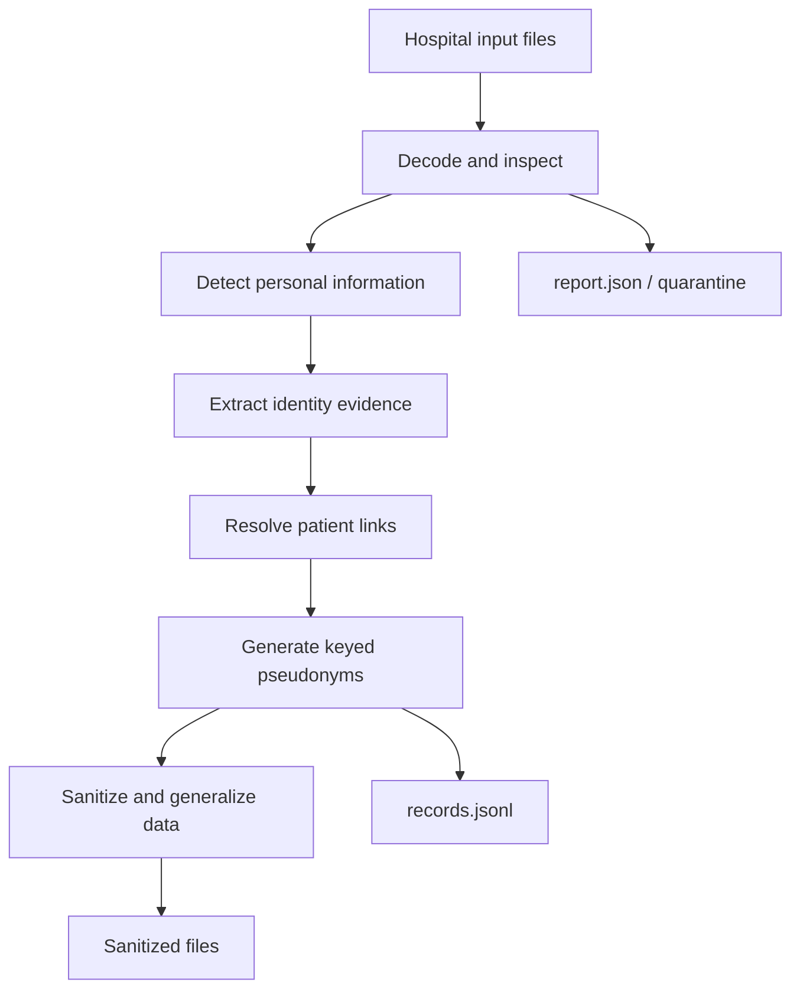

<div align="center">

# 🛡️ SECRET WARDS
### Privacy Firewall for Multi-Hospital Patient Records

**Team Runtime Terrors**

<p>
  
  
  
  
</p>

*Protect patient identity. Preserve the value of clinical data.*

</div>

---

## 🌟 Overview

**Secret Wards** is an offline, rule-based privacy pipeline designed to de-identify patient records collected from multiple hospitals. It processes structured and text-based records, detects personal information across English, Hindi, and Hinglish patterns, links records when identity evidence is strong enough, and produces sanitized data with audit-friendly output files.

The system is designed to run locally on a CPU without calling hosted AI services or requiring an internet connection during processing.

## ✨ Key Capabilities

| Capability | What it does |
|---|---|
| 🔎 **PII detection** | Uses field-aware rules, patterns, and contextual checks to identify personal information. |
| 🌐 **Multilingual handling** | Includes detection and normalization support for English, Hindi, and Hinglish text. |
| 🔗 **Patient record linking** | Uses identity evidence and conflict checks to link records belonging to the same patient. |
| 🪪 **Stable pseudonyms** | Generates keyed pseudonyms using HMAC and the `RAKSHA_SECRET` environment variable. |
| 🧹 **Data sanitization** | Redacts detected identifiers and applies age banding and patient-specific date shifting where supported. |
| 📁 **Safe file handling** | Processes supported text formats and quarantines files that cannot be safely processed. |
| 📊 **Audit outputs** | Produces a per-file report and a JSONL record-to-pseudonym mapping. |

## 🧠 How It Works



### Processing stages

1. **Ingest** — Read supported CSV, TSV, JSON, and TXT files.
2. **Detect** — Identify personal identifiers using field names, patterns, and contextual rules.
3. **Resolve** — Compare identity evidence and link records conservatively to reduce false merges.
4. **Pseudonymize** — Generate stable, keyed patient pseudonyms.
5. **Sanitize** — Redact detected personal information and apply supported generalization and date shifting.
6. **Report** — Write sanitized outputs, processing details, and record mappings.

## ⚙️ Quick Start

### Requirements

- Python **3.10 or newer**
- No third-party runtime packages are required by the current pipeline
- A local secret supplied through the environment variable `RAKSHA_SECRET`

### 1. Clone the repository

```bash
git clone <YOUR_REPOSITORY_URL>
cd SECRET-WARDS
```

### 2. Set the secret

Use the secret provided by the challenge runner. For local practice, set a private development value in your terminal:

```bash
export RAKSHA_SECRET='your-private-local-practice-secret'
```

> 🔐 Keep this value private. Do not commit it, paste it into source code, or include it in screenshots or reports. Use the same secret for repeat runs when stable pseudonyms are required.

### 3. Run the pipeline

```bash
python main.py --input /path/to/input --output /path/to/output
```

Replace the paths with the input and output directories provided for your environment.

## 📦 Output Structure

A successful run creates an output directory with this general structure:

```text
output/
├── sanitized/       # Sanitized files, preserving safe folder organization
├── records.jsonl    # Record-to-pseudonym mapping
└── report.json      # Per-file processing status and hashes
```

Files that are unsupported, malformed, empty, or unsafe to process are quarantined rather than copied as if they had been safely sanitized.

## 🧪 Run Tests

From the project root:

```bash
python -m pytest -q
```

The challenge runner configuration is defined in `raksha.toml`.

## 🔐 Privacy–Utility Approach

The pipeline aims to reduce exposure of direct identifiers while retaining useful clinical information. Depending on the field and available evidence, it can redact detected identifiers, generalize exact ages into bands, and shift supported dates using a patient-specific offset.

This is a trade-off: generalized ages and shifted dates are less exact than the source values. Clinical usefulness and privacy protection must be evaluated together on the target dataset.

## ⚠️ Known Limitations

- Rule-based detection can miss unseen spellings, unusual formats, or identifiers without sufficient context.
- Multilingual and transliterated text can contain variations that are difficult to detect exhaustively.
- Conservative record linking may leave some records unlinked; incorrect merges are also a risk whenever identity evidence is ambiguous.
- Rare combinations of clinical facts may still create re-identification risk.
- Passing format or contract validation does **not** prove that all personal information has been removed.
- This is a hackathon/student project, not a certified or production-ready medical de-identification system.

## 👥 Team

**Runtime Terrors**

Built for the Secret Wards challenge.

---

<div align="center">

**🛡️ Privacy by design. Clinical utility by care.**

</div>
