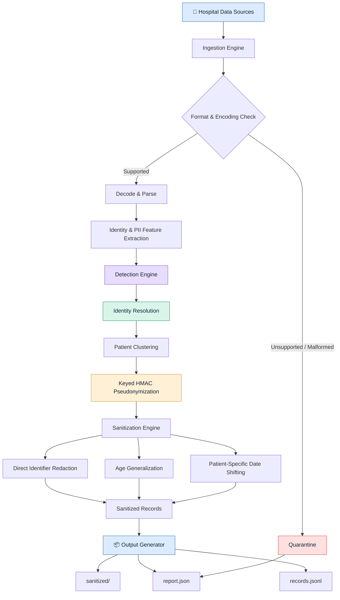

# 🛡️ SECRET WARDS
### Privacy-Preserving Healthcare Data Sanitization

<p align="center">
  
  
  
  
</p>

<p align="center">
  <strong>Turning sensitive healthcare records into safer, research-ready data without throwing away their clinical value.</strong>
</p>

---

## 🌐 Overview

Healthcare data is valuable for research, public health analysis, and improving medical outcomes. However, hospital records often contain personally identifiable information (PII), including patient names, phone numbers, government identifiers, addresses, dates, and details that can reveal someone's identity when combined.

**Secret Wards** is an offline healthcare data sanitization pipeline designed to detect and remove direct identifiers, link records belonging to the same patient, and assign stable pseudonymous identities while preserving useful clinical information.

Instead of treating every document as an isolated file, the pipeline uses identity evidence across records to maintain consistent pseudonyms. It combines structured-field inspection, contextual detection, text normalization, cross-script name handling, and keyed HMAC pseudonymization.

Our objective is to balance two competing requirements:

- 🔒 **Privacy:** Reduce the possibility of identifying patients from released records.
- 🩺 **Clinical utility:** Preserve medicines, dosages, diagnoses, laboratory values, and other information needed for meaningful research.

> **Core idea:** Protect the identity of the patient, not the clinical value of the record.

---

## ✨ Key Features

| Feature | Description |
|---|---|
| 📂 Multi-format ingestion | Processes CSV, TSV, JSON, and text records |
| 🔍 Context-aware detection | Uses patterns, field names, labels, and contextual rules to identify sensitive information |
| 🇮🇳 Indian identity handling | Includes normalization for Indian name structures and common Hindi/English transliteration variants |
| 🔗 Patient record linkage | Uses identity evidence across records to associate records with the same patient |
| 🪪 Stable pseudonyms | Generates keyed HMAC-based patient identifiers using `RAKSHA_SECRET` |
| 📅 Date shifting | Applies deterministic, patient-specific date offsets |
| 🎂 Age generalization | Converts exact ages into five-year age bands |
| 🧹 Sensitive data cleaning | Sanitizes supported structured and unstructured content |
| 🧾 Auditable reporting | Generates a SHA-256-based processing report |
| 🚧 Safe quarantine | Isolates unsupported, malformed, or unsafe files instead of copying them unchanged |
| 🌐 Offline execution | Runs without requiring network access during processing |

---

## 🏗️ System Architecture

The pipeline follows a two-pass processing approach.

### Architecture diagram



### 🔄 Two-pass processing

**Pass 1 — Discovery and identity resolution**

1. Traverse the input directory.
2. Decode supported files using available encoding fallbacks.
3. Extract patient identity clues and record-level information.
4. Detect identifiers and normalize relevant names.
5. Compare identity evidence across records.
6. Build patient clusters and assign stable pseudonyms.

**Pass 2 — Sanitization and export**

1. Revisit the input files.
2. Apply patient-specific pseudonyms and date offsets.
3. Redact detected direct identifiers.
4. Generalize supported age fields.
5. Sanitize supported structured and unstructured content.
6. Quarantine files that cannot be safely processed.
7. Generate `report.json` and `records.jsonl`.

---

## ⚙️ How It Works

### 1. 📥 Ingestion Engine

The ingestion layer discovers files recursively and processes supported formats.

**Currently supported formats**

| Format | Handling |
|---|---|
| CSV | Reads structured rows and columns |
| TSV | Reads tab-separated records |
| JSON | Handles nested JSON structures |
| TXT | Processes free-text medical notes |
| Unsupported or malformed files | Quarantined instead of exported unchanged |

The pipeline includes decoding support for common encodings such as UTF-8, UTF-8 with BOM, UTF-16, and CP1252.

Files that cannot be safely decoded or processed are not treated as sanitized data.

### 2. 🔍 Personal Data Detection

The detection engine combines multiple rule-based signals instead of relying on a single regular expression.

Its current detection approach includes:

- **Field-aware detection:** Recognizes sensitive fields using column names and JSON keys.
- **Pattern matching:** Identifies common phone numbers, Aadhaar-like identifiers, ABHA identifiers, and hospital record numbers.
- **Contextual detection:** Uses surrounding labels and phrases to identify patient names, relatives, and other identifying details.
- **Name normalization:** Normalizes names by removing common honorifics and handling selected spelling variants.
- **Cross-script handling:** Includes custom Devanagari-to-Latin transliteration support for identity comparison.
- **Nested data inspection:** Traverses structured JSON values and checks relevant nested content.
- **Hidden-content inspection:** Checks supported Base64-encoded text and sensitive file paths.

#### The meaning trap

Healthcare documents contain words and numbers that can look like personal identifiers but are actually clinical information.

For example:

| Content | Correct interpretation |
|---|---|
| `Dr. Ramesh` | Doctor name, not automatically a patient identifier |
| `C/O Ramesh` | Relative information that may identify a patient |
| `C/O fever` | Clinical complaint, not a relative's name |
| `Ramipril 5 mg` | Medicine and dosage |
| `Dolo 650 BD x 5 days` | Medicine, dosage, frequency, and duration |
| `1-0-1` | Medication frequency, not a phone number |
| `Parkinson's disease` | Medical diagnosis, not a person's name |

The goal is to remove identifying information without unnecessarily destroying clinical meaning.

### 3. 🔗 Patient Identity Resolution

A single patient may appear in multiple hospitals, formats, and languages.

Secret Wards extracts identity candidates and compares records using available evidence, including:

- Normalized patient names.
- Relative-name information.
- Hospital-scoped record identifiers.
- Phone numbers and other available identifiers.
- Name variants and transliteration clues.
- Conflicting identity evidence.

The record-linking process uses evidence-based comparisons and conflict checks to reduce incorrect merges.

When evidence is insufficient, a record can remain unlinked rather than being assigned to a potentially incorrect patient.

**Important principle:** A missed link is preferable to confidently merging two different patients.

### 4. 🪪 Keyed Pseudonymization

After identity resolution, the pipeline generates stable patient pseudonyms.

Pseudonyms are created using **HMAC-SHA256**, keyed by the environment variable `RAKSHA_SECRET`.

Conceptually:

```python
digest = hmac.new(
    secret,
    patient_identity.encode("utf-8"),
    hashlib.sha256
).digest()
```

The resulting digest is converted into a compact pseudonymous patient identifier.

Example:

```text
PSN-7Q2K9D
```

**Why keyed HMAC instead of plain hashing?**

- Plain hashing can be vulnerable to dictionary attacks when identifiers have predictable values.
- HMAC requires a secret key to generate or verify the corresponding pseudonym.
- The same secret and patient identity produce a stable pseudonym.
- A different secret produces different pseudonyms.

The secret is read from the environment and is not intentionally written into the generated release.

### 5. 🛡️ Privacy Layer

The pipeline applies the following privacy transformations where supported.

| Privacy technique | Purpose |
|---|---|
| Direct identifier redaction | Removes detected names, phone numbers, and sensitive identifiers |
| Age banding | Converts exact ages into five-year ranges |
| Patient-specific date shifting | Applies a deterministic date offset per patient |
| Address sanitization | Removes or masks detected address information |
| Filename sanitization | Checks sensitive identifiers in supported file paths |
| Quarantine | Prevents unsafe or unsupported files from being released as sanitized data |

#### Age generalization

Instead of publishing an exact age:

```text
Original: 47
Sanitized: 45-49
```

The resulting age band retains useful demographic information while reducing precision.

#### Patient-specific date shifting

The pipeline derives a deterministic date offset using the patient identity and secret.

This allows dates belonging to the same patient to be shifted consistently, helping preserve relative intervals between supported dates.

#### Privacy versus utility

More aggressive sanitization can reduce privacy risk, but it can also destroy valuable clinical information.

Secret Wards aims to preserve:

- Medicines and dosages.
- Medication frequency.
- Diagnoses and procedures.
- Laboratory values and units.
- Vital measurements.
- Useful patient-level demographic information.

Rare-value suppression and full quasi-identifier protection remain areas for further development.

---

## 📦 Output Structure

The challenge requires the pipeline to produce the following structure:

```text
output/
│
├── sanitized/
│   ├── registration/
│   ├── discharge/
│   ├── prescriptions/
│   └── ...
│
├── report.json
│
└── records.jsonl
```

### 1. `sanitized/`

Contains the cleaned versions of supported input files.

The pipeline aims to preserve the original supported file format and directory structure while sanitizing sensitive information.

Files that cannot be safely processed are quarantined rather than copied as clean output.

### 2. `report.json`

Provides an auditable summary of the processing operation.

It includes:

- SHA-256 hashes of input files.
- Sanitized or quarantined status.
- Output file mappings.
- Processing counts.
- Record statistics.
- Timing information.
- Resource usage.

Example structure:

```json
{
  "files": [
    {
      "input_sha256": "9f2c...",
      "output": "sanitized/discharge/note1.txt",
      "status": "sanitized"
    },
    {
      "input_sha256": "51aa...",
      "output": null,
      "status": "quarantined",
      "reason": "unsupported format"
    }
  ],
  "counts": {
    "files_total": 817,
    "files_sanitized": 809,
    "files_quarantined": 8,
    "records_processed": 5756,
    "identifiers_detected": 21950,
    "records_linked": 5690
  }
}
```

*The values above are illustrative examples, not claimed results from a current run.*

### 3. `records.jsonl`

Maintains a mapping between exported records and their pseudonymous patient identities.

Example:

```json
{"file":"sanitized/registration/hospital.csv","loc":"row:12","patient":"PSN-7Q2K9D"}
{"file":"sanitized/opd/visits.json","loc":"/visits/3","patient":"PSN-7Q2K9D"}
{"file":"sanitized/discharge/note1.txt","loc":"doc","patient":"PSN-7Q2K9D"}
```

The same patient should receive the same pseudonym across records.

When identity evidence is insufficient, the patient value should be `null` rather than an unreliable identity assignment.

---

## 🧰 Technology Stack

| Technology | Usage |
|---|---|
| Python 3 | Core processing pipeline |
| Python `re` | Pattern-based identifier detection |
| `hashlib` | SHA-256 file fingerprints |
| `hmac` | Keyed pseudonym generation |
| `base64` | Encoding and decoding supported Base64 content |
| `csv` | CSV and TSV processing |
| `json` | Structured JSON processing |
| `argparse` | Command-line interface |
| `pathlib` | File and directory traversal |
| `pytest` | Automated testing |

The current implementation primarily uses Python's standard library, keeping the runtime lightweight and suitable for offline execution.

---

## 🚀 Getting Started

### Prerequisites

- Python 3.10 or newer.
- Git.
- A terminal or command prompt.

### 1. Clone the repository

```bash
git clone https://github.com/IshikaSharma04/SECRET-WARDS.git

cd SECRET-WARDS
```

### 2. Install dependencies

```bash
pip install -r requirements.txt
```

The current pipeline uses Python standard-library functionality, so additional package installation is not required for its present implementation.

### 3. Configure the secret

The pipeline requires `RAKSHA_SECRET` for pseudonymization and deterministic date shifting.

For local development:

```bash
export RAKSHA_SECRET="local-practice-only"
```

On Windows PowerShell:

```powershell
$env:RAKSHA_SECRET="local-practice-only"
```

Use the secret supplied by the challenge environment during evaluation. Never hardcode it in source code, commit it, or include it in output files.

### 4. Run the pipeline

```bash
python main.py --input /path/to/input --output /path/to/output
```

Example using a local practice dataset:

```bash
export RAKSHA_SECRET="practice"

python main.py \
  --input dev/input \
  --output my_output
```

### 5. Run the tests

```bash
python -m pytest -q
```

---

## 🧪 Evaluation & Practice Results

The pipeline was tested against the supplied Secret Wards practice toolkit.

### Latest recorded practice run

| Metric | Result |
|---|---:|
| Input files | 200 |
| Sanitized files | 194 |
| Quarantined files | 6 |
| Records processed | 817 |
| Records linked | 763 |
| PII leakage | 58 / 3,230 (1.8%) |
| Medical values preserved | 91.2% |
| Identity precision | 0.96 |
| Identity recall | 0.76 |
| Identity F0.5 | 0.91 |
| Incorrect patient merges | 1 |
| Raw unsupported file copies | 0 |
| Output contract validation | `CONTRACT OK` |

### What these results tell us

- The pipeline successfully processed the majority of the supplied practice files.
- It preserved a substantial portion of the tested clinical information.
- Its identity-linking precision was higher than its recall, reflecting a preference for avoiding uncertain links.
- Some personal information still survived sanitization, particularly in challenging Hindi/Hinglish and structured-data cases.
- One incorrect identity merge was observed and needs further investigation.

**These are practice-dataset results, not hidden-dataset scores or a guarantee of final evaluation performance.**

---

## 🧪 Validation

The Secret Wards challenge provides tools to check output structure and submission readiness.

Run the output validator:

```bash
python3 validate_output.py \
  --input dev/input \
  --output my_output/
```

Expected successful contract message:

```text
CONTRACT OK
```

Run the submission checker:

```bash
python3 check_submission.py \
  --repo . \
  --run
```

Expected successful readiness message:

```text
READY TO SUBMIT
```

A successful contract or readiness check confirms the relevant structural checks. It does not prove that all personal information has been removed or that the system is free from re-identification risk.

---

## 🔐 Security Design

Secret Wards follows several security-oriented design principles:

- **Secret separation:** Pseudonymization keys are supplied through environment variables.
- **Keyed pseudonyms:** Patient identifiers use HMAC rather than plain, unkeyed hashing.
- **Offline runtime:** The pipeline does not need network access to process records.
- **Input integrity:** Input files are identified in the report using SHA-256 hashes.
- **Quarantine-first handling:** Unsupported and unsafe files are not intentionally released as sanitized copies.
- **PII-conscious reporting:** Processing output focuses on aggregate counts rather than intentionally printing patient details.

### Current security limitations

Encryption of raw and intermediate data at rest is not yet implemented by the application. The runtime environment must therefore provide appropriate storage encryption and access controls.

The project also requires further hardening of temporary-file handling, logging, and privacy checks before it could be considered suitable for real healthcare deployment.

---

## ⚖️ Privacy–Utility Trade-off

Healthcare anonymization is not simply about deleting every identifier.

Removing too much information can make a dataset unusable for medical research. Keeping too much information can expose patients to re-identification attacks.

Secret Wards uses a combination of redaction, pseudonymization, age banding, and date shifting to preserve useful information while reducing direct exposure.

| Information | Intended treatment |
|---|---|
| Patient names | Redact detected values |
| Phone numbers | Redact detected values |
| Aadhaar-like and hospital identifiers | Redact detected values |
| Exact age | Convert to a five-year band |
| Supported dates | Apply patient-specific shifts |
| Medicines and dosages | Preserve |
| Diagnoses | Preserve where not identifying |
| Vitals and laboratory values | Preserve |
| Unsupported or unsafe files | Quarantine |

The remaining risk comes from information that is not directly identifying on its own but can become identifying when combined with external knowledge.

Examples include rare diagnoses, village names, admission dates, and combinations of demographic characteristics.

---

## 🚧 Known Limitations & Future Work

We believe privacy engineering requires honest reporting of what a system does and does not protect.

The current implementation has the following limitations:

| Area | Current limitation | Planned improvement |
|---|---|---|
| Hindi and Hinglish detection | Some names and identifying phrases remain undetected | Expand transliteration, gazetteers, and contextual detection |
| JSON sanitization | Some sensitive JSON keys and values can survive | Improve recursive key and value sanitization |
| Identity resolution | Incorrect merges are still possible | Improve evidence thresholds and homonym separation |
| Quasi-identifiers | Full k-anonymity is not implemented | Add group-size analysis and rare-value suppression |
| Location generalization | Full location hierarchy is not implemented | Generalize village, district, and PIN information |
| Encryption | Application-level encryption at rest is not implemented | Add authenticated encryption and key separation |
| FHIR | Full FHIR R4 validation and reference preservation require further work | Add comprehensive FHIR validation |
| Re-identification risk | A complete quantitative risk assessment is not yet implemented | Measure uniqueness and attack resistance on practice data |

### Our next priorities

1. Reduce surviving identifiers across English, Hindi, and Hinglish.
2. Improve patient-linking accuracy without increasing false merges.
3. Implement genuine quasi-identifier generalization and suppression.
4. Add encryption and stronger temporary-data protection.
5. Strengthen format validation and FHIR R4 handling.
6. Measure re-identification risk rather than assuming that redaction alone provides anonymity.

---

## 👥 Team

**Team Runtime Terrors**

Track 3 · Secret Wards

Built as a privacy-preserving healthcare data sanitization project.


<p align="center">
  <strong>🛡️ Secret Wards — Protecting patient identity while preserving the value of healthcare data.</strong>
</p>
